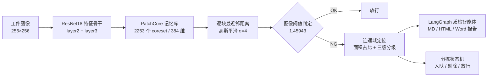
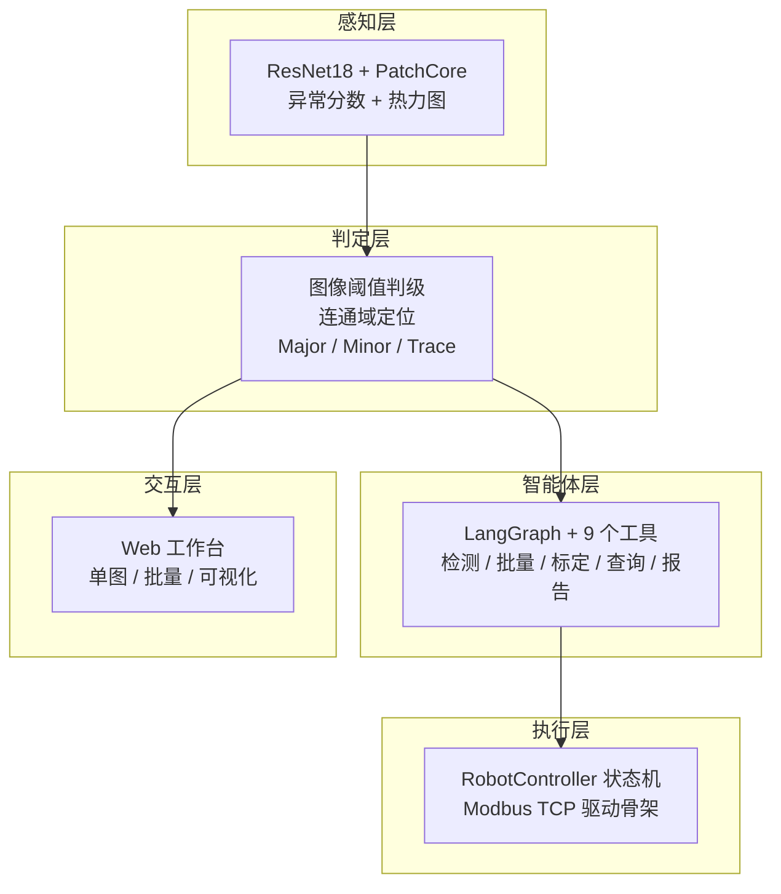
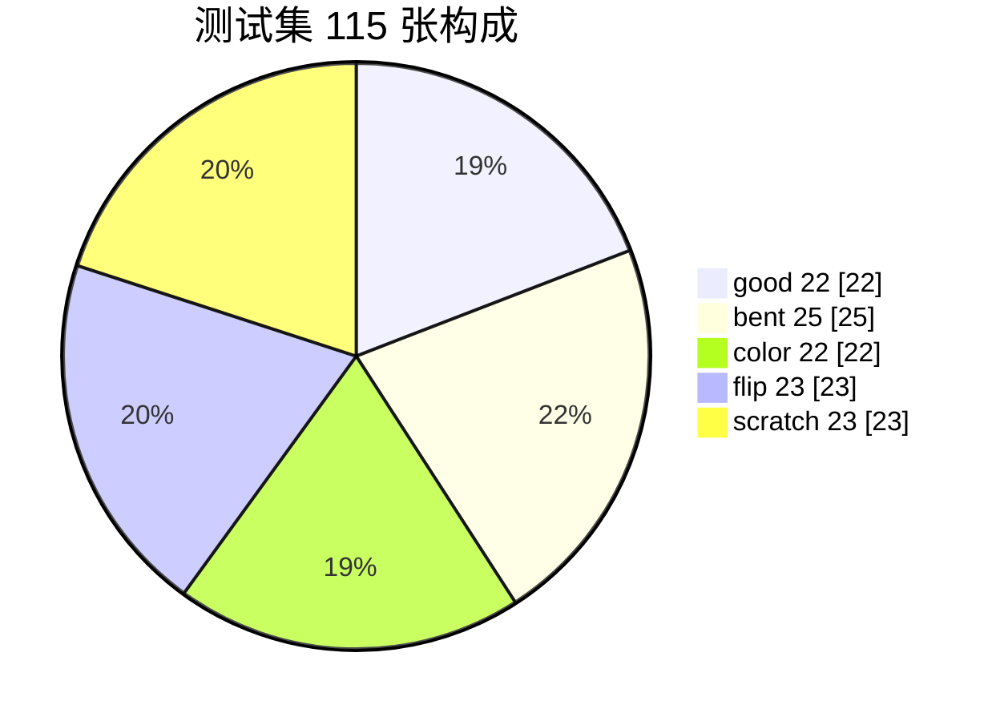
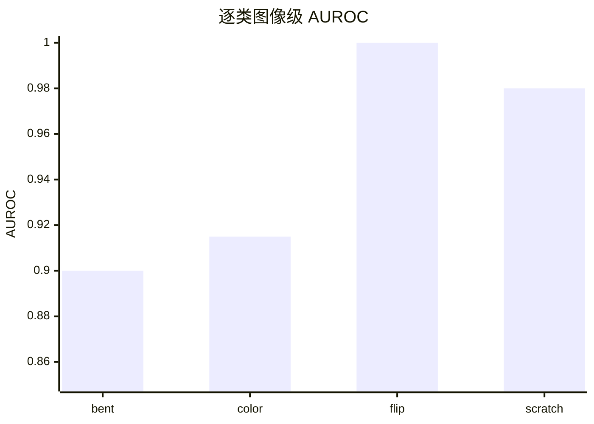
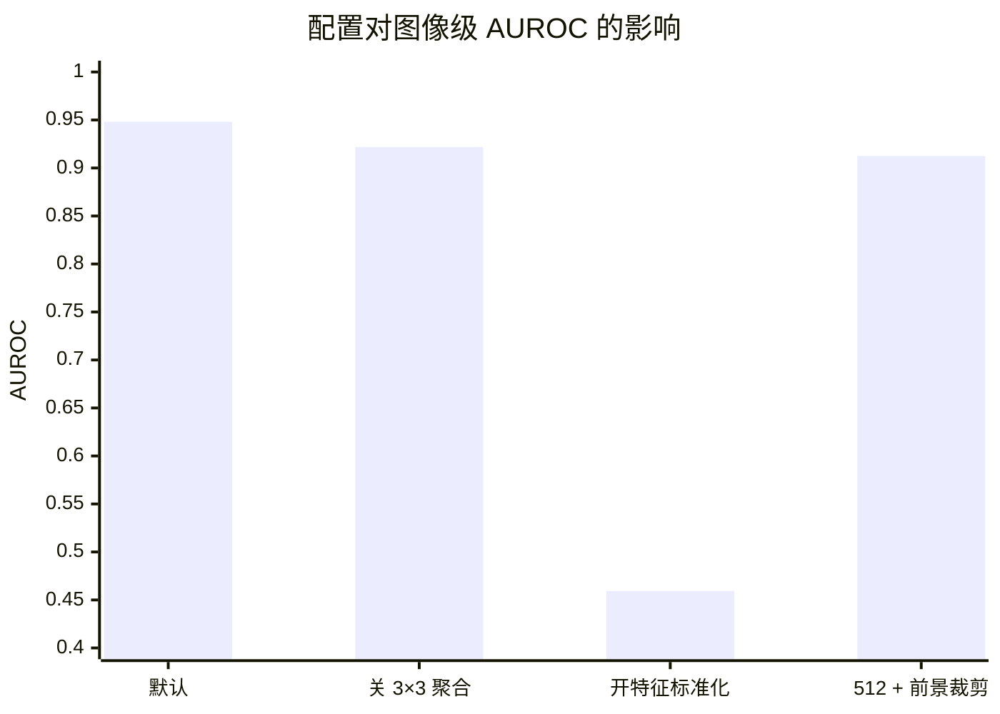

# 螺母缺陷检测与自动分拣

面向多品种、小批量金属螺母产线的无监督质检与自动分拣系统：只用正常件建模，训练阶段零缺陷标注；输入一张工件图像，输出 OK / NG、缺陷位置、面积占比和三级严重度，生成可追溯报告，NG 件进入分拣队列。

## 1. 关键数据速查

先看结论：训练只用 220 张正常件、零缺陷标注；115 张测试集图像级 AUROC 0.9482、召回 91.4%；RK3588 板端端到端 55.5 毫秒、约 18 帧每秒。下表是全部可报的数字，汇报时按需取用。

| 项目 | 数值与口径 |
|---|---|
| 数据集 | MVTec AD metal_nut，700×700 RGB；训练 220 张正常件，测试 115 张（good 22 / bent 25 / color 22 / flip 23 / scratch 23） |
| 输入与骨干 | ResNet18 取 layer2+layer3，输入 256×256，32×32 块网格，每块 384 维 |
| 记忆库 | 225280 个描述子，k-center 采 1% 得 2253 个核心块；3×3 邻域聚合，σ=4 |
| 阈值 | max(P99.5, mean+3σ)=1.45943；像素阈值 1.413090 |
| 图像级 AUROC | 0.9482 |
| 像素级 / PRO | 像素级 AUROC 0.9584；PRO 0.8207 |
| 阈值下指标 | 准确率 0.8957、精确率 0.9551、召回 0.9140、F1 0.9341 |
| 混淆矩阵 | TN 18、FP 4、FN 8、TP 85；准确率=(18+85)/115 |
| 逐类 AUROC | bent 0.900、color 0.915、flip 1.000、scratch 0.980 |
| 消融·关 3×3 | 图像级降到 0.9218 |
| 消融·开标准化 | 掉到 0.4594 |
| 消融·512+裁剪 | 图像级 0.9125、PRO 0.8587、训练 181 秒（约 8.6 倍） |
| 板端 | NanoPi M6 / RK3588，FP16 RKNN+C++；55.5 ms（读取 13、推理 18–22、后处理 23–30），约 18 fps，单路单进程 |
| 泄漏事件 | 224 张泄漏模型 AUROC 0.9824 已隔离；220 张干净模型 0.9482 为交付口径 |
| 分拣 | 仿真 7 项单测通过；Modbus TCP 仅骨架，真机未联调 |

## 2. 业务问题

这类产线的特点不是缺陷多，而是缺陷少、品类多、换型勤。

- **样本成本**：监督检测要收集缺陷再逐张标注，每换一个品类就要重做一遍，成本随品类增长。
- **缺陷稀缺**：划伤、弯曲、变色、装配翻转四类缺陷都是低频事件，凑不出稳定训练集，也覆盖不了没见过的形态。
- **人工目检**：漏检率和判定一致性受人员状态、光照、节拍影响，记录与追溯靠人工整理。
- **执行断点**：检出 NG 后仍要人工拿走，检测结果与分拣动作之间没有闭环。

对应五个验收维度：检测精度、单图时延、板端可运行、报告可追溯、分拣可闭环。

## 3. 系统架构

系统按感知、判定、报告、执行四段做，段间只传结构化结果、不传中间图像。

系统按“感知—判定—报告—执行”四段组织，段间只传结构化结果、不传中间图像，每一段可单独替换和测试。

## 4. 五层模块

模块分五层：感知、判定、智能体、执行、交互，判定层独立于模型，智能体不参与判定。

判定层独立于模型：阈值与分级标准可按产线调整，不必改模型；智能体不参与 OK/NG 判定，只做编排与表达。

## 5. 数据构成

训练只用正常件，测试集 115 张里合格 22、缺陷 93。

| 项 | 数量 | 说明 |
| --- | --- | --- |
| 训练集 | 220 张正常件 | 仅 `train/good`，只读使用 |
| 测试集 | 115 张 | 合格 22 + 缺陷 93 |
| 缺陷像素标注 | 仅评估使用 | 训练阶段完全不接触 |

## 6. 实测结果

图像级 AUROC 0.9482、像素级 0.9584，当前阈值下召回 91.4%，8 张漏检集中在弯曲。

| 指标 | 数值 |
| --- | --- |
| 图像级 AUROC | 0.9482 |
| 像素级 AUROC | 0.9584 |
| PRO | 0.8207 |
| 准确率 | 0.8957 |
| 精确率 | 0.9551 |
| 召回率 | 0.9140 |
| F1 | 0.9341 |

| 混淆矩阵 | 预测 OK | 预测 NG |
| --- | --- | --- |
| 实际正常 22 | TN 18 | FP 4 |
| 实际缺陷 93 | FN 8 | TP 85 |

逐类图像级 AUROC：

单图推理：PC 端 27–29 ms（RTX 4060 独占）；板端 55.5 ms（RK3588 FP16，约 18 帧/秒）；训练约 21 秒。

## 7. 消融实验

两个开关都不能动：关掉邻域聚合掉 0.026，开特征标准化崩到 0.46。

| 配置 | 图像 AUROC | 像素 AUROC | PRO | F1 | 训练耗时 |
| --- | --- | --- | --- | --- | --- |
| 默认（256 / 3×3 / 不标准化） | 0.9482 | 0.9584 | 0.8207 | 0.9341 | 21 s |
| 关 3×3 邻域聚合 | 0.9218 | 0.9380 | 0.8012 | 0.8876 | 18 s |
| 开特征标准化 | 0.4594 | 0.7364 | 0.6548 | 0.0825 | 17 s |
| 512 + 前景裁剪 | 0.9125 | 0.9380 | 0.8587 | 0.8824 | 181 s |

结论：邻域聚合对局部纹理缺陷必要；特征标准化会抹平正常与异常的距离分布；512 定位最好但图像级下降、训练耗时约 8.6 倍，不采用。

## 8. 板端性能

端到端 55.5 毫秒，后处理占一半以上，是当前优化的重点。

| 阶段 | 耗时 |
| --- | --- |
| 图像读取 | 约 13 ms |
| NPU 推理（FP16） | 18–22 ms |
| 后处理（kNN / 归一化 / 连通域） | 23–30 ms |
| 端到端 | 55.5 ms / 帧（约 18 fps） |

板端阈值：图像 1.45943、像素 1.413090；115 张分类结果与 PC 完全对齐（TN 18 / FP 4 / FN 8 / TP 85）。后处理是当前占比最大的一段，优化重点是 coreset 检索、后处理向量化与多线程、读取与推理流水重叠。

## 9. 证据强度

证据分四档，任何一档都不往上说一档。

| 等级 | 内容 |
| --- | --- |
| 已实测 | 板端单路推理 55.5 ms；数据集全部指标 |
| 已跑通 | 单图/批量检测、三种格式报告、网页工作台 |
| 仅仿真 | 分拣状态机（7 项单元测试通过） |
| 未验证 | 真机抓取、PLC、产线光电触发、多路并发、现场节拍 |

## 10. 交付边界

交付的是板端可运行、产线未联调的验证版本。

检测、报告、网页、板端单路推理和仿真分拣链路已经跑通；真实机械臂、PLC、光电触发和连续运行尚未现场联调。18 帧/秒是单路、单进程、固定输入的实测值，不等于产线节拍。网页和单元测试里的机械臂动作都是仿真，不代表真机能抓。

下一步：真机与 PLC 联调、多路并发压测、按品类采集正常样本并重标阈值。

## 11. 关键配置

参数一句话可报完；数据治理口径是 0.9482，不是泄漏模型的 0.9824。

ResNet18 layer2 + layer3，输入 256×256，32×32 块网格，每块 384 维，3×3 邻域聚合；220 张正常件共 225280 个描述子，k-center 采样 1% 得 2253 个核心块；阈值取 `max(P99.5, mean+3σ)`。

数据治理：2026-11-11 重训曾混入 4 张测试集正常图，图像 AUROC 虚高至 0.9824；该模型已隔离，交付口径为 220 张干净模型的 0.9482。

## 12. 技术路线与取舍

三条路里只有无监督成立，因为训练阶段只有正常件。

| 路线 | 前提条件 | 在本项目的问题 | 结论 |
| --- | --- | --- | --- |
| 监督检测（YOLO 系列） | 需要缺陷框和足量缺陷样本 | 训练阶段只有正常件，监督条件不成立；强行训练只能覆盖已见形态 | 不采用 |
| 传统规则 / 阈值分割 | 光照、批次、位形稳定 | 四类缺陷要分别设计规则，维护成本随品类线性增长 | 不采用 |
| 无监督异常检测（PatchCore） | 只需正常件 | 无法给出缺陷类别名，只能给位置与严重度 | 采用 |

选 PatchCore 的三个理由：只学正常分布，偏离即报警，未见过形态也能检出；机制直观，热力图直接对应图像位置，便于解释；训练约 21 秒，结构简单，可导出 ONNX 上板。代价是分类别能力弱，四类缺陷靠位置、面积和人工复核区分，这是当前方案的已知短板。

## 13. 算法机制

PatchCore 的假设是正常件在特征空间形成一个分布，缺陷块会偏离这个分布。

1. **提特征切块**：ResNet18 取 layer2（128 维）与 layer3（256 维）拼接，256×256 输入得到 32×32 块网格，每块 384 维。
2. **建记忆库**：220 张正常件、每张 1024 块，共 225280 个描述子；k-center 贪心采样 1%，得 2253 个核心块。
3. **打分**：测试时每块到记忆库找最近邻距离，3×3 邻域聚合后高斯平滑（σ=4），取最大值作为图像分数；分数超过 1.45943 判 NG。

为什么块级而不是整图：划痕、变色只占工件一小块，整图池化会被大面积正常纹理稀释，块级才能保住微弱信号。为什么采样 1%：225280 个描述子全量检索的内存与时延不可接受，1% 是精度和时延的工程折中，实测该配置达标。为什么用 ResNet18：板端算力约束，更大骨干未做验证。

## 14. 智能体与分拣链路

智能体只做编排和表达、不判 OK 或 NG；分拣只到仿真，真机未联调。

**质检智能体**：LangGraph 四个节点编排 9 个工具，覆盖单图检测、批量检测、阈值标定、结果查询、报告渲染，输出 Markdown、HTML、Word 三种报告；没有大模型 API 时降级为规则引擎，报告链路仍可用。智能体只做编排与表达，不参与 OK / NG 判定——判定必须可复现、可追溯。

**分拣执行**：RobotController 加状态机，负责 NG 入队、取件、剔除、OK 放行，并带安全约束；仿真 7 项单元测试全部通过，验证的是队列行为和状态迁移，不代表真机能抓。Modbus TCP 目前只有驱动骨架，缺 IO 点表、限位、真空、防护门和急停联调。

